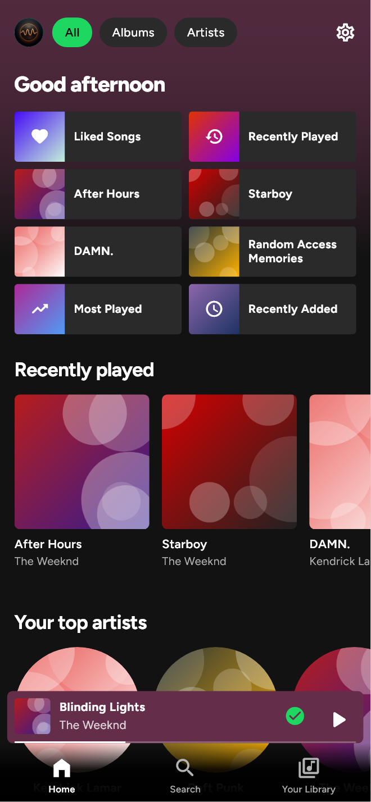
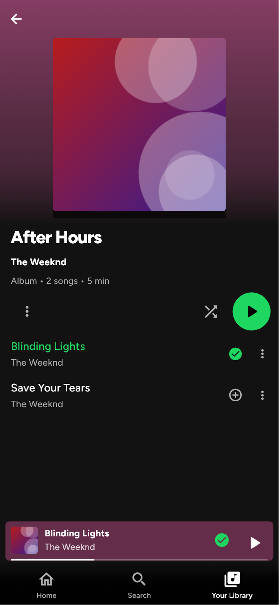
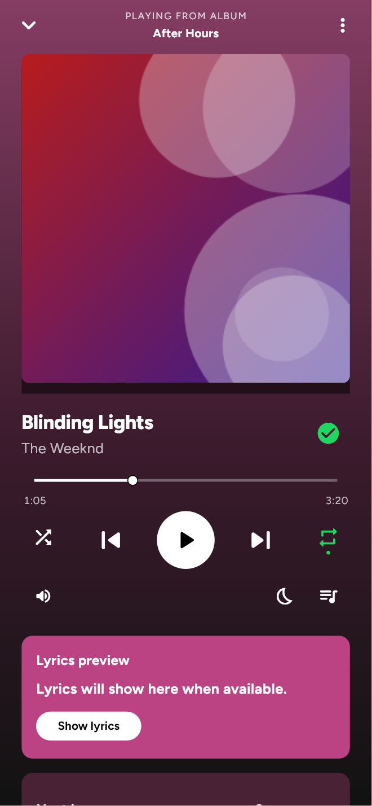
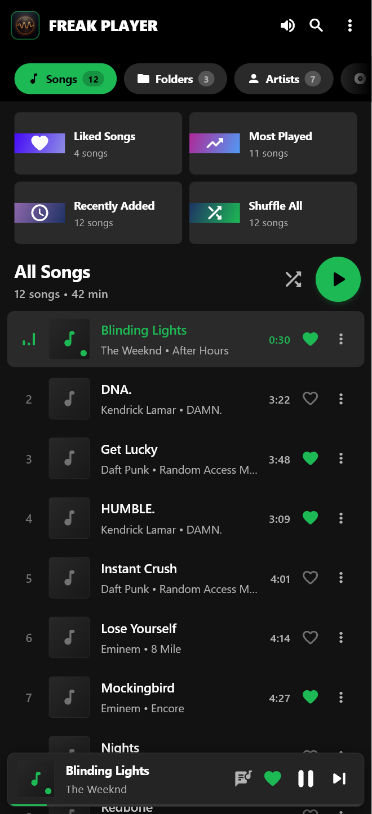
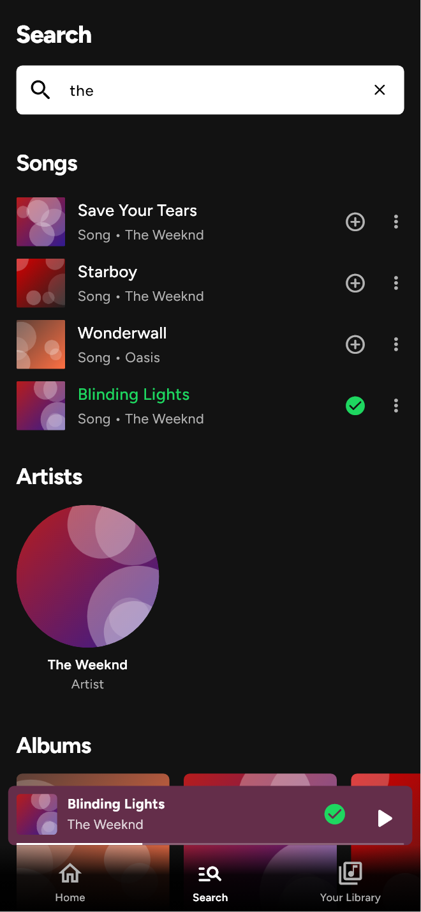

# FreakFM 📻

A Spotify-inspired **offline** music player for **Android** and **Windows**, built with Flutter: your local library, synced lyrics, a real equalizer, and proper lock-screen / Bluetooth controls — no accounts, ads or tracking.

<p align="center">
  
  
  
  
  
</p>

**[⬇️ Download the latest APK](https://github.com/Alferid69/freak_shit_show/releases/latest)** — pick `arm64-v8a` if you're not sure which one you need.

---

## ✨ Features

### Library
- **Finds all your music.** Every song Android's media library knows about — anywhere on the phone or SD card — plus a scan of common folders (Music, Download, Telegram and WhatsApp audio, Snaptube/Vidmate, Bluetooth…) and any folder you add.
- **You stay in control of folders.** Don't want something in your library (for example recordings or voice notes)? Hide that folder from its page or a song's ⋮ menu; manage added and hidden folders in **Settings** (tap your avatar).
- **Nothing gets lost.** Likes, play counts and real track durations are saved automatically and survive rescans.
- **Accurate tags.** Title, artist, album, genre, year, duration, bitrate and cover art are read from the file (MP3, FLAC, M4A, OGG/Opus, WAV…), with sensible fallbacks from the file name.
- Browse **albums, artists, folders and genres**, plus built-in playlists: **Liked Songs, All Songs, Most Played, Recently Added, Recently Played**.

### Playback
- `just_audio` engine with **shuffle that remembers** what you heard (Previous goes back to it) and repeat off / all / one.
- **Play next** and **Add to queue** from any song's menu, plus a queue view where you can jump to, remove, shuffle or clear songs.
- **Real equalizer on Android** — presets plus per-band sliders driving the device's audio effects.
- Playback speed (0.5×–2×), ±10 s skip, and a sleep timer (minutes or end of track).
- Pauses when headphones or Bluetooth disconnect, and ducks/pauses for calls and other apps.
- Lock-screen, notification, Bluetooth and headset controls with cover art; the notification can be swiped away while paused.
- Files that can't be played show a message and are skipped — no fake progress.

### Lyrics
- Lyrics embedded in the file are used first, then free online sources (LRCLIB, Lyrics.ovh), choosing the result that matches the song's artist and length.
- Synced lyrics auto-scroll with the music on a cover-coloured, full-screen page; tap a line to jump there. A live lyrics card sits under the player controls.
- Results are cached for offline use; "no lyrics" answers are remembered for a week.
- **Share lyric cards**: pick up to 5 lines, choose a gradient, then share to any app or save the image to your gallery.

---

## 🎨 UI & UX

The app is laid out like Spotify (design notes in [`DESIGN.md`](DESIGN.md)): a bottom bar with **Home, Search and Your Library**, a floating mini player, and colour taken from your cover art throughout.

| Where | What you get |
| --- | --- |
| **Home** | "Good morning/afternoon/evening", filter pills (All / Albums / Artists), a two-column grid of shortcuts (Liked Songs, recently played albums, Most Played…), then shelves: **Recently played, Your top artists, Your mixes** (one per genre) and **Recently added**. The top of the page is tinted with your latest cover. |
| **Search** | White search bar, coloured **Browse all** genre tiles with tilted covers (your top genres first). Typing shows songs, artists, albums, genres and folders, or "Couldn't find…" when nothing matches. |
| **Your Library** | Pinned **Liked Songs** and **All Songs**, then albums and artists. Filter pills (Artists, Albums, Folders, Genres), sort by Recents / Recently added / Alphabetical / Most played, list or grid view, pull down to rescan, **+** to add a folder. |
| **Album / artist / playlist pages** | Header gradient from the cover colour, big cover (round for artists), title and details, ⋮ menu (shuffle play, add to queue, hide folder), shuffle toggle and the green ▶ button. Artist pages add a Discography shelf. The title appears in the top bar as you scroll. |
| **Songs** | Tap to play. The **+** saves to Liked Songs (green tick when saved). **⋮** or long-press: *Play next, Add to queue, Like, Song info, Hide this folder*. The playing song is green with a small equalizer. |
| **Mini player** | Floats above the bottom bar, tinted with the cover colour, with like and play/pause and a thin progress line. Tap or **swipe up** to expand; **swipe left/right** to skip. |
| **Now Playing** | Full screen on the cover's colour: "Playing from …", large cover (swipe to skip), title + like, seek bar that seeks on release, shuffle/repeat with green dots, sleep timer and queue. Scroll for the **lyrics card**, **Next in queue** and **About this song**. ⋮ has Go to album/artist, speed and sleep timer. |
| **Lyrics** | Full-screen on a bright cover colour: big bold lines, the current line white and upcoming lines dimmed; share lyric cards from the top right. |
| **Back button** | Closes the open page first, then returns to Home, and only then leaves the app. Re-tapping a tab jumps back to its first page. |

Typography is **Figtree** (bundled, SIL Open Font License), close to Spotify's geometric style. Counts read naturally ("1 song"), times as `3:07`, and long titles never overflow, even on small phones.

---

## 📱 Platforms

- **Android** 7.0+ (API 24) — APKs for `arm64-v8a`, `armeabi-v7a` and `x86_64`
- **Windows** 10/11 (x64)

Permissions on Android: *Music and audio* (to read your songs), *Internet* (lyrics only), and the media-playback foreground service. The app never asks for "All files access".

---

## 🛠️ Tech Stack

- **Framework**: Flutter 3.44 / Dart 3.12
- **Audio**: `just_audio` (+ `just_audio_windows`), `audio_session`, `audio_service`
- **Tags & artwork**: `audio_metadata_reader`; Android `MediaMetadataRetriever` / MediaStore via Kotlin (off the UI thread)
- **Storage**: `shared_preferences`, `path_provider`, atomic JSON caches

---

## 🚀 Getting Started

### Prerequisites
- [Flutter SDK](https://docs.flutter.dev/get-started/install) 3.44+
- Android SDK / Android Studio (for Android builds)
- Visual Studio 2022+ with the "Desktop development with C++" workload (for Windows builds)

### Run it
```bash
git clone https://github.com/Alferid69/freak_shit_show.git
cd freak_shit_show
flutter pub get
flutter run            # connected Android device, or -d windows
```

### Build release binaries
```bash
flutter build apk --release --split-per-abi   # one APK per CPU architecture
flutter build windows --release
```

---

## 🧪 Tests

```bash
# Unit + widget tests (add --tags network to also hit the live lyrics API)
flutter test --exclude-tags network

# Integration tests on a real device/desktop: scanning rules, search, likes,
# playback, queue ("Play next"), Back-button navigation and error handling
flutter test integration_test/app_test.dart -d <android-device-id>
```

---

## 🤖 CI & Releases

- **CI** (`.github/workflows/ci.yml`) runs on every push and pull request to `main`: `flutter analyze`, unit tests, and the integration suite on an **Android emulator**.
- **Release** (`.github/workflows/release.yml`) runs when a `v*` tag is pushed (or manually). After the full test suite passes it builds one APK per ABI and publishes them, with SHA-256 checksums, to a GitHub Release.

```bash
# bump `version:` in pubspec.yaml first, then:
git tag v1.3.0 && git push origin v1.3.0
```

To sign releases with your own key, add the repository secrets `ANDROID_KEYSTORE_BASE64`, `ANDROID_KEYSTORE_PASSWORD`, `ANDROID_KEY_ALIAS` and `ANDROID_KEY_PASSWORD`. Without them the APKs are debug-signed (installable, but not Play Store-ready).

---

## 📄 License

Open source under the MIT License.
