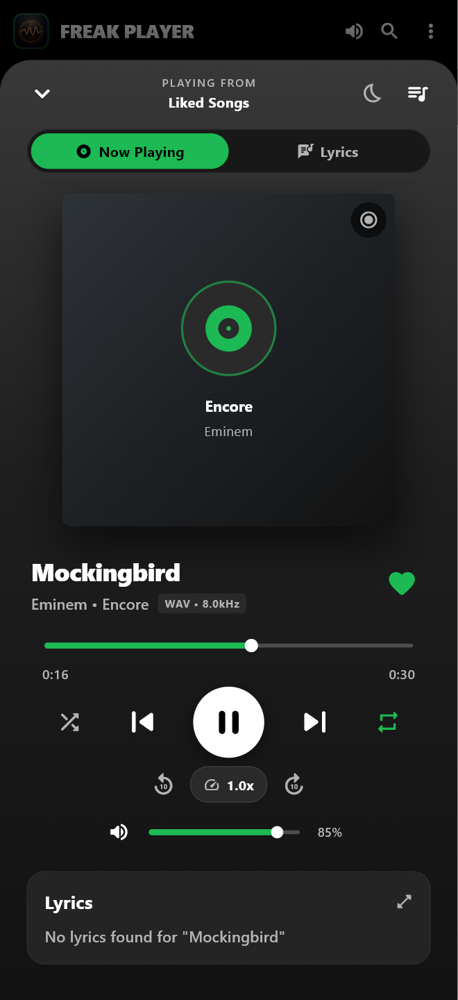
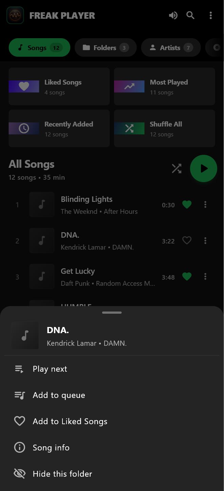
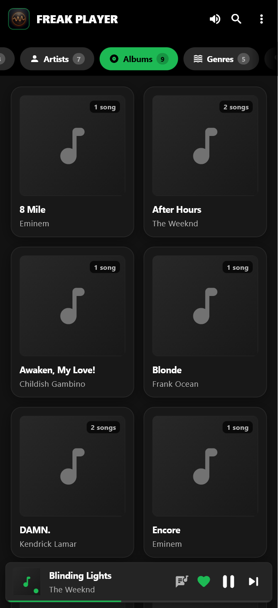

# freak player 🎵

A Spotify-inspired **offline** music player for **Android** and **Windows**, built with Flutter: your local library, synced lyrics, a real equalizer, and proper lock-screen / Bluetooth controls — no accounts, ads or tracking.

<p align="center">
  
  
  
  
</p>

**[⬇️ Download the latest APK](https://github.com/Alferid69/freak_shit_show/releases/latest)** — pick `arm64-v8a` if you're not sure which one you need.

---

## ✨ Features

### Library
- **Scans only your music.** Music and Download folders by default, plus any folder you add. Audio that other apps keep for themselves (Quran readers, WhatsApp/Telegram voice notes, podcast apps), `.nomedia` folders, ringtones, alarms and notification sounds are skipped.
- **You stay in control of folders.** Hide a folder from the Folders tab or a song's menu; manage added and hidden folders under **⋮ → Library folders**.
- **Nothing gets lost.** Likes, play counts and real track durations are saved automatically and survive rescans.
- **Accurate tags.** Title, artist, album, genre, year, duration, bitrate and cover art are read from the file (MP3, FLAC, M4A, OGG/Opus, WAV…), with sensible fallbacks from the file name.
- Browse by **Songs, Folders, Artists, Albums, Genres and Favorites**, with search across all of them and five sort orders.

### Playback
- `just_audio` engine with **shuffle that remembers** what you heard (Previous goes back to it) and repeat off / all / one.
- **Play next** and **Add to queue** from any song's menu, plus a queue view where you can jump to, remove, shuffle or clear songs.
- **Real equalizer on Android** — presets plus per-band sliders driving the device's audio effects.
- Playback speed (0.5×–2×), ±10 s skip, and a sleep timer (minutes or end of track).
- Pauses when headphones or Bluetooth disconnect, and ducks/pauses for calls and other apps.
- Lock-screen, notification, Bluetooth and headset controls with cover art; the notification can be swiped away while paused.
- Files that can't be played show a message and are skipped — no fake progress.

### Lyrics
- Lyrics embedded in the file are used first, then free online sources (LRCLIB, Lyrics.ovh), choosing the result that matches the song's artist and length.
- Synced lyrics auto-scroll with the music; tap a line to jump there. A live preview of the current line sits under the player controls.
- Results are cached for offline use; "no lyrics" answers are remembered for a week.
- **Share lyric cards**: pick up to 5 lines, choose a gradient, then share to any app or save the image to your gallery.

---

## 🎨 UI & UX

The interface follows a Spotify-style dark design (see [`DESIGN.md`](DESIGN.md)). Things worth knowing:

| Where | What you can do |
| --- | --- |
| **Top tabs** | Swipe between tabs or tap a pill — the selected pill always scrolls into view. The right edge fades when more tabs are off-screen. |
| **Songs tab** | Quick tiles for **Liked Songs, Most Played, Recently Added, Shuffle All**, a big ▶ to play everything in order and 🔀 to shuffle. **Pull down to rescan.** Drag the scrollbar to jump through large libraries. |
| **Any song** | Tap to play. Tap **⋮** or **long-press** for *Play next, Add to queue, Like, Song info, Hide this folder*. |
| **Mini player** | Tap or **swipe up** to open the full player; **swipe left/right** to skip tracks. |
| **Full player** | Shows where the music is *playing from* (album, artist, folder, search, Liked Songs…). Dragging the seek bar previews the time and seeks once you let go. Speed and EQ chips sit under the transport; the queue and sleep timer are in the header. |
| **Albums / Artists / Genres / Folders** | Open one to see its songs. The **system Back button** closes it first, then returns to Songs, and only then leaves the app. |
| **Search** | Filters songs, artists, albums, folders and genres as you type; shows a clear "No results" message instead of an empty library. |
| **Desktop** | Windows gets an in-app volume slider (phones use the hardware buttons). |

Polish: tooltips on icon buttons, screen-reader labels on the tab pills, correct singular/plural counts ("1 song"), and times shown as `3:07` / `1:02:07`.

---

## 📱 Platforms

- **Android** 7.0+ (API 24) — APKs for `arm64-v8a`, `armeabi-v7a` and `x86_64`
- **Windows** 10/11 (x64)

Permissions on Android: *Music and audio* (to read your songs), *Internet* (lyrics only), and the media-playback foreground service. The app never asks for "All files access".

---

## 🛠️ Tech Stack

- **Framework**: Flutter 3.44 / Dart 3.12
- **Audio**: `just_audio` (+ `just_audio_windows`), `audio_session`, `audio_service`
- **Tags & artwork**: `audio_metadata_reader`; Android `MediaMetadataRetriever` / MediaStore via Kotlin (off the UI thread)
- **Storage**: `shared_preferences`, `path_provider`, atomic JSON caches

---

## 🚀 Getting Started

### Prerequisites
- [Flutter SDK](https://docs.flutter.dev/get-started/install) 3.44+
- Android SDK / Android Studio (for Android builds)
- Visual Studio 2022+ with the "Desktop development with C++" workload (for Windows builds)

### Run it
```bash
git clone https://github.com/Alferid69/freak_shit_show.git
cd freak_shit_show
flutter pub get
flutter run            # connected Android device, or -d windows
```

### Build release binaries
```bash
flutter build apk --release --split-per-abi   # one APK per CPU architecture
flutter build windows --release
```

---

## 🧪 Tests

```bash
# Unit + widget tests (add --tags network to also hit the live lyrics API)
flutter test --exclude-tags network

# Integration tests on a real device/desktop: scanning rules, search, likes,
# playback, queue ("Play next"), Back-button navigation and error handling
flutter test integration_test/app_test.dart -d <android-device-id>
```

---

## 🤖 CI & Releases

- **CI** (`.github/workflows/ci.yml`) runs on every push and pull request to `main`: `flutter analyze`, unit tests, and the integration suite on an **Android emulator**.
- **Release** (`.github/workflows/release.yml`) runs when a `v*` tag is pushed (or manually). After the full test suite passes it builds one APK per ABI and publishes them, with SHA-256 checksums, to a GitHub Release.

```bash
# bump `version:` in pubspec.yaml first, then:
git tag v1.2.0 && git push origin v1.2.0
```

To sign releases with your own key, add the repository secrets `ANDROID_KEYSTORE_BASE64`, `ANDROID_KEYSTORE_PASSWORD`, `ANDROID_KEY_ALIAS` and `ANDROID_KEY_PASSWORD`. Without them the APKs are debug-signed (installable, but not Play Store-ready).

---

## 📄 License

Open source under the MIT License.
